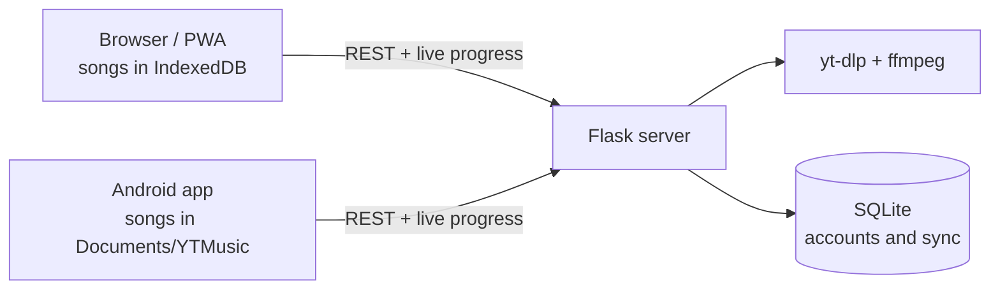

# Music Downloader

> [!NOTE]
> This project was built with the help of AI coding assistants. Every change was reviewed, tested and decided on by its author.

Search for a song or paste a YouTube link, download it as M4A or MP3 and listen whenever you like, even offline. It comes with a full player, your own playlists, a radio mode and a library that follows you across devices. It runs in the browser, installs as a web app (PWA) and has its own Android app.

**Try it at [music.dannarita.es](https://music.dannarita.es)** · **[Download the Android app](https://github.com/Ten1O0/YouTube-Music-Downloader/releases/latest)**

[](https://python.org)
[](https://flask.palletsprojects.com/)
[](https://vitejs.dev/)
[](https://developer.mozilla.org/en-US/docs/Web/Progressive_web_apps)
[](mobile/README.md)
[](https://github.com/Ten1O0/YouTube-Music-Downloader/actions/workflows/ci.yml)
[](LICENSE)

<p align="center">
  
  
  
  
</p>

<sub>Screenshots use a sample library with made-up artists and generated covers (`node scripts/capturas-readme.mjs`).</sub>

---

## Features

**Download**
- Single songs, Shorts or whole YouTube playlists (up to 100 songs per batch, three at a time, with a single notification at the end).
- **M4A** by default: YouTube's own AAC track (~128 kbps), not re-encoded, so it's fast and lossless. **MP3** (VBR, ~190 kbps, converted with `ffmpeg`) for older players. Both keep the cover art and tags.
- Listen before downloading: songs play through YouTube's embedded player, and when a video can't be embedded they're fetched quietly into a cache instead. Keeping a song you already previewed doesn't download it again.
- Import playlists from other services as a CSV (Exportify, TuneMyMusic, Soundiiz…) or as plain text, one song per line. The app finds each song on YouTube and you pick which ones to download.

**Listen**
- Offline. In the browser songs are stored on the device (IndexedDB); on Android they go to `Documents/YTMusic/`, where any other player can open them too.
- A complete player: drag-to-reorder queue, shuffle and repeat, synced lyrics (from LRCLIB), lock-screen controls and a ⋮ menu for every song.
- **Radio mode**: when the queue ends, or from any song, similar music keeps playing, spread across many artists of the same style. Upcoming songs are prepared in advance, and one tap saves the one you like.
- Sound options: gapless or crossfade, volume normalisation, a visualiser, and a background that takes on the colours of the cover art.

**Organise**
- Your library by song or by artist, with favourites, your own playlists and automatic ones (*Most played*, *Recently added*, *Not played yet*).
- Playlists like in a music app: a header with cover and total duration, search and sort inside a list, a chosen cover, "download the missing ones", multi-select, swipe to remove and undo instead of confirmation dialogs.
- Recommendations in every playlist you create: similar songs picked from several of its songs and artists, never more than two from the same artist.
- Fix a song's title or artist when YouTube gets them wrong.
- *Your year in music*: a summary of what you listened to most, to view or share as an image.

**Your account, if you want one**
- Everything above works without an account. Sign in with Google and your library, playlists, favourites and listening history sync across your devices. You can also follow a YouTube playlist and get its new songs as they're added.
- Deleted songs stay in a trash bin for 30 days. You can export a backup file, restore it on another device and delete your account from Settings.
- Available in English, Spanish, French, German, Portuguese and Chinese. The browser's language is used by default.

<p align="center">
  
</p>

---

## Install

- **Browser:** open [music.dannarita.es](https://music.dannarita.es). On a phone, "Add to Home screen" installs it like any other app.
- **Android:** download `ytmusic.apk` from the [latest release](https://github.com/Ten1O0/YouTube-Music-Downloader/releases/latest) and install it (Android will ask for permission to install apps from outside Google Play). The app tells you when a new version is out.

> [!NOTE]
> **Upgrading from a version before 2.0?** 2.0 is signed with a new key, so Android won't install it over the old one. Uninstall the old app once and install the new one; your data comes back when you sign in, or from a backup. Later versions install over it as usual.
>
> SHA-256 fingerprint of the signing certificate:
> `07:28:11:95:C2:A9:F3:7A:21:C4:7D:97:14:01:61:9E:28:F1:E2:91:53:C0:AD:D5:91:9D:C1:53:07:89:BA:0F`

---

## Run it locally

You need **Python 3.10+**, **Node.js 22+** (it builds the interface, and `yt-dlp` uses it to solve YouTube's challenges) and **FFmpeg** on your `PATH`.

```bash
git clone https://github.com/Ten1O0/YouTube-Music-Downloader.git
cd YouTube-Music-Downloader

python3 -m venv .venv
source .venv/bin/activate          # Windows: .venv\Scripts\activate
pip install -r backend/requirements.txt

npm install
npm run build                      # the server serves the built interface from dist/

# The server refuses to start without a key to sign sessions
export JWT_SECRET="$(python3 -c 'import secrets; print(secrets.token_urlsafe(48))')"

python backend/server.py
```

Open **http://localhost:5000**.

> [!TIP]
> If downloads start failing with a YouTube error, update `yt-dlp` first: `pip install -U yt-dlp yt-dlp-ejs` (they go together). YouTube changes often and yt-dlp catches up quickly.

### Development

For hot reload, run `python backend/server.py` in one terminal and `npm run dev` in another, then open `http://localhost:5173` (Vite forwards `/api` to port 5000).

```bash
pip install -r test/requirements-test.txt ruff
npm test               # backend (pytest) and frontend (node --test)
npm run test:e2e       # end-to-end flows in a real browser (Playwright)
npm run lint           # ESLint
ruff check .           # Python lint
```

The end-to-end tests use a fake `yt-dlp` that generates synthetic audio, so they need no internet. GitHub Actions runs everything on every pull request and every push to `main`.

| Variable | Default | Purpose |
|---|---|---|
| `JWT_SECRET` | **required** | Key used to sign sessions. |
| `YTDL_DATA_DIR` | `data/` | Where the SQLite database lives. Keep it outside the project in production. |
| `PORT` / `HOST` | `5000` / `0.0.0.0` | Where `python backend/server.py` listens. Use `HOST=127.0.0.1` to keep it off your local network. |

### Android app

```bash
npm run sync:apk -- --debug    # a debug APK (on Windows: npm run sync:apk:win)
```

The interface is bundled **inside** the APK, which is why it works offline, but interface changes only reach the phone with a new APK. Signing and release details are in [`mobile/README.md`](mobile/README.md).

---

## How it works



1. The app asks the server for a download and gets an ID back right away; the work continues in the background.
2. The server runs `yt-dlp` to extract the audio (and `ffmpeg` to convert it, for MP3).
3. The app follows progress over Server-Sent Events, falling back to polling if needed.
4. When it's done, the app fetches the file and stores it on the device. From then on it plays offline.
5. The server deletes its copy; a periodic sweep removes anything left behind.

With an account, each device keeps its full library and also records every change in a log that syncs through your account. What you do offline is sent as soon as you're back online, and what you delete on one device disappears on all of them.

| Path | Contents |
|---|---|
| `backend/` | Flask server: API, downloads, radio, batches, playlist import, SQLite access. |
| `frontend/` | The interface, in plain JavaScript modules with no framework (`src/features/` holds one folder per feature). |
| `mobile/` | Android project (Capacitor). |
| `scripts/` | APK build, README screenshots and server maintenance tasks. |
| `test/` | Backend, frontend and browser tests. See [`test/README.md`](test/README.md). |
| `docs/planes/` | The design notes behind every change (in Spanish). |

---

## Self-hosting

Before deploying under your own domain, change:

- `ALLOWED_ORIGINS` in `backend/server.py`: the origins allowed to call the API.
- `SERVIDOR` in `frontend/src/config/env.js`: the server the Android app talks to.
- `GOOGLE_CLIENT_ID` in `backend/server.py` and `frontend/src/features/auth.js`, if you want Google sign-in. You need your own client ID with your domain authorised.
- The APK signing key (see [`mobile/README.md`](mobile/README.md)).

Run it with gunicorn behind a reverse proxy, using **one worker with many threads**: download progress lives in the process's memory, so several workers would lose track of it.

```bash
gunicorn --workers 1 --threads 32 --timeout 120 \
    --bind 127.0.0.1:5000 --chdir backend server:app
```

- Bind to `127.0.0.1`, never `0.0.0.0`: the proxy must be the only way in.
- Pass `X-Forwarded-For` and `X-Forwarded-Proto` from the proxy; the server uses them to rate-limit by real client IP.
- Turn off proxy buffering for `/api/progress/stream/`, or progress only shows up at the end.
- `scripts/servidor/` installs a daily timer that updates `yt-dlp` and checks it still extracts audio, and another that checks followed playlists for new songs.

To avoid drawing YouTube's attention, downloads are capped at 200 songs per hour per user (or IP) and 1,000 per hour for the whole server. If YouTube starts asking the server to prove it isn't a bot, new downloads pause for 10 minutes.

---

## Limitations

- **Single process.** The server can't be spread across several workers or machines.
- **Depends on YouTube.** When YouTube changes something, downloads may fail until `yt-dlp` is updated.
- **Not on Google Play**, whose rules don't allow apps that download from YouTube.

## Privacy

No ads and no trackers. Without an account, your music and playlists only exist on your device. With one, the server stores your email, name, Google profile picture and what you sync, and you can delete all of it from Settings. The download log, used to measure how much the service is used, is deleted after 90 days. Full details in the [privacy policy](https://music.dannarita.es/privacidad).

## License and disclaimer

Released under the [MIT License](LICENSE).

This is a personal project, not affiliated with YouTube or Google. Downloading content from YouTube may go against its terms of service or the rights of whoever published it: only use it with content you have the right to download.
