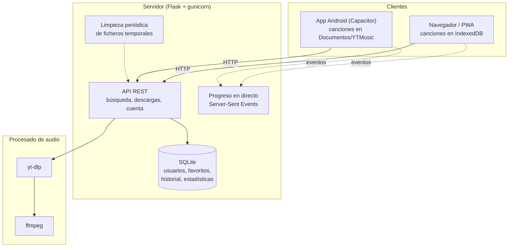

# Music Downloader

Busca una canción o pega un enlace de YouTube, descárgala en M4A o MP3 y escúchala cuando quieras, también sin conexión. Funciona en el navegador, se instala como aplicación web (PWA) y tiene su propia app para Android.

Puedes probarla en **[music.dannarita.es](https://music.dannarita.es)**.

[](https://python.org)
[](https://flask.palletsprojects.com/)
[](https://vitejs.dev/)
[](https://developer.mozilla.org/es/docs/Web/Progressive_web_apps)
[](mobile/README.md)
[](test/README.md)
[](LICENSE)

---

## Qué puedes hacer

- **Buscar y descargar** canciones sueltas, *shorts* o listas de reproducción enteras (hasta 100 canciones por lote).
- **Elegir el formato:**
  - **M4A** *(por defecto)*: la pista de audio tal como la sirve YouTube, AAC a unos 128 kbps, sin recodificar. Es la opción más rápida y no pierde calidad.
  - **MP3**: se convierte con `ffmpeg` a VBR V2 (unos 190 kbps) y lleva la carátula y los metadatos incrustados. Es la opción para reproductores antiguos que no leen M4A.
- **Ver el progreso en directo** en una tarjeta flotante mientras descarga, y cancelar cuando quieras.
- **Escuchar sin conexión.** En el navegador, las canciones se guardan en el propio dispositivo y siguen ahí al recargar o sin internet. En Android van a `Documentos/YTMusic/`, así que cualquier reproductor puede abrirlas.
- **Usar un reproductor completo**, con cola que se ordena arrastrando, modo aleatorio y repetición, letras sincronizadas y controles en la pantalla de bloqueo.
- **Organizar tu biblioteca** con favoritos y listas propias.
- **Iniciar sesión con Google** si quieres. No hace falta para nada de lo anterior. Si la inicias, tu historial de descargas y tus favoritos se guardan en tu cuenta y te siguen a cualquier dispositivo.
- **Usarla en tu idioma:** español, inglés, francés, alemán, portugués y chino. Se detecta el del navegador y se puede cambiar a mano.

---

## Pruébala en tu equipo

### Requisitos

- **Python 3.10** o superior. En producción se usa Python 3.12. Con 3.9 `pip install` falla, porque gunicorn 25 no publica paquetes para esa versión.
- **Node.js 20** o superior. Sirve para compilar la interfaz, y además `yt-dlp` lo usa para resolver las comprobaciones de YouTube, así que tiene que estar en el `PATH` también en el servidor.
- **FFmpeg** en el `PATH`: `sudo apt install ffmpeg` en Linux, `brew install ffmpeg` en macOS. En Windows también vale descomprimido en `ffmpeg-master-latest-win64-gpl/` dentro del proyecto.

### En cinco minutos

```bash
git clone https://github.com/Ten1O0/YouTube-Music-Downloader.git
cd YouTube-Music-Downloader

python3 -m venv .venv
source .venv/bin/activate          # En Windows: .venv\Scripts\activate
pip install -r requirements.txt

# El servidor no arranca sin una clave para firmar las sesiones
export JWT_SECRET="$(python3 -c 'import secrets; print(secrets.token_urlsafe(48))')"

python server.py
```

Abre **http://localhost:5000** y ya está. El servidor sirve la interfaz directamente y no necesitas compilar nada para empezar.

> [!TIP]
> Si una descarga falla con un error de YouTube, lo primero es actualizar `yt-dlp`: YouTube cambia a menudo y yt-dlp va detrás. Consulta [Actualizar dependencias](#actualizar-dependencias).

---

## Cómo funciona



Esto es lo que pasa cuando pulsas "Descargar":

1. **La app pide la descarga** (`POST /api/start-download`) y el servidor devuelve un identificador al momento. El trabajo sigue en segundo plano.
2. **El servidor lanza `yt-dlp`**, que extrae el audio. Si pediste MP3, `ffmpeg` lo convierte. Como la conversión consume mucha CPU, solo se hacen dos a la vez.
3. **La app escucha el progreso** por un canal de *Server-Sent Events* y lo pinta en la tarjeta flotante. Si ese canal no está disponible, pasa sola a preguntar cada pocos segundos.
4. **Al terminar, la app se lleva el fichero** y lo guarda en el dispositivo: en IndexedDB en el navegador y en `Documentos/YTMusic/` en Android. Desde ese momento suena sin conexión.
5. **El servidor borra su copia.** Lo que quede huérfano lo retira una limpieza periódica al cabo de una hora.

Cada descarga queda anotada, con o sin sesión, para saber cuánto se usa el servicio. Si has iniciado sesión, además va a tu historial.

### Tus favoritos en varios dispositivos

Con sesión iniciada, la lista de favoritos de tu cuenta es la que manda. Al abrir la app o al iniciar sesión, el dispositivo adopta la lista de la cuenta, así que un favorito que borraste en el móvil también desaparece en el ordenador. Si en lugar de eso se juntaran las listas de cada dispositivo, lo borrado volvería a aparecer.

Lo que marcas sin conexión, o sin haber iniciado sesión, no se pierde: queda apuntado como pendiente y se envía a la cuenta en cuanto vuelve la conexión o la sesión. La primera vez que inicias sesión en un dispositivo, los favoritos que ya tenía se suman a tu cuenta.

### Estructura del proyecto

| Ruta | Qué contiene |
|---|---|
| `server.py` | El servidor: API, descargas, progreso y limpieza. |
| `database.py` | Acceso a SQLite: usuarios, historial, favoritos y estadísticas. |
| `index.html`, `app.js`, `styles.css` | La interfaz completa, sin framework. |
| `download.html` | Página de descarga de la app Android. |
| `public/` | Service worker y manifiesto de la PWA. |
| `mobile/` | Proyecto Android con Capacitor. Tiene su [propio README](mobile/README.md). |
| `test/` | Tests de backend, frontend y recorridos en navegador. Ver su [README](test/README.md). |
| `docs/planes/` | Los planes de mejora con los que se ha ido rehaciendo el proyecto, y el porqué de cada decisión. |

---

## Desarrollo

### Con recarga en caliente

```bash
# Terminal 1: la API
source .venv/bin/activate
python server.py

# Terminal 2: la interfaz con Vite
npm install
npm run dev
```

La interfaz queda en `http://localhost:5173` y Vite reenvía las llamadas a `/api` al servidor del puerto 5000.

### Variables de entorno

| Variable | Obligatoria | Por defecto | Para qué sirve |
|---|:---:|---|---|
| `JWT_SECRET` | **Sí** | — | Clave con la que se firman las sesiones. Sin ella el servidor no arranca. |
| `YTDL_DATA_DIR` | No | `./data` | Carpeta de la base de datos. En producción conviene sacarla del directorio del proyecto (ver [Despliegue](#desplegar-tu-propia-instancia)). |
| `PORT` | No | `5000` | Puerto de `python server.py`. |
| `HOST` | No | `0.0.0.0` | Interfaz en la que escucha `python server.py`. Por defecto acepta conexiones de toda tu red local; usa `HOST=127.0.0.1` si no quieres eso. |
| `YTDL_SKIP_BOOTSTRAP` | No | — | Evita crear la base de datos y los hilos de limpieza al importar el módulo. Solo para los tests. |

### Tests

```bash
npm test                              # backend y frontend de una vez
.venv/bin/pytest test/backend -q      # solo backend
node --test test/frontend/*.mjs       # solo frontend
npm run test:e2e                      # recorridos en un navegador real
.venv/bin/ruff check .                # estilo y errores comunes en Python
```

Los recorridos de Playwright usan un `yt-dlp` simulado (`test/e2e/fake_ytdlp/`) que genera un segundo de audio sintético, así que no necesitan internet y siempre dan el mismo resultado. Cada cambio que llega a `main` los ejecuta en GitHub Actions.

### Actualizar dependencias

Las versiones de `requirements.txt` están fijadas a propósito: sin fijar, un despliegue podía traer una versión nueva y tumbar el servicio sin que nadie hubiera tocado el código.

`yt-dlp` es la excepción que hay que vigilar, porque es lo primero que se rompe cuando YouTube cambia algo. Para actualizarlo:

```bash
pip install -U yt-dlp yt-dlp-ejs      # van emparejados
pip freeze | grep -i yt-dlp           # y llevar las versiones a requirements.txt
```

Antes de desplegar, prueba **una búsqueda, una descarga suelta y una lista de reproducción**.

---

## App Android

```bash
npm run sync:apk          # Linux y macOS
npm run sync:apk:win      # Windows
```

El script compila la interfaz, la copia al proyecto Android y genera `ytmusic.apk`.

La interfaz va **dentro** de la APK, no se descarga del servidor. Por eso funciona sin conexión, pero también significa que un cambio en la interfaz no llega al móvil hasta que se genera e instala una APK nueva. Los detalles están en [`mobile/README.md`](mobile/README.md).

---

## Desplegar tu propia instancia

### Qué cambiar antes

El proyecto está configurado para `music.dannarita.es`. Para otro dominio hay que cambiarlo en:

- **`server.py`, `ALLOWED_ORIGINS`**: los orígenes que pueden llamar a la API.
- **`app.js`, `getApiBase`, `API_URL` y las URL de `/auth/native`**: a dónde llama la app Android, que no tiene un dominio propio del que tirar.
- **`GOOGLE_CLIENT_ID`**, en `server.py` y en `app.js`, si quieres inicio de sesión con Google. Necesitas un ID de cliente propio con tu dominio autorizado en la consola de Google Cloud; con el de este proyecto Google rechaza cualquier otro origen.

### Instalación en el servidor

```bash
git clone https://github.com/Ten1O0/YouTube-Music-Downloader.git /var/www/youtube-downloader
cd /var/www/youtube-downloader
python3 -m venv .venv && .venv/bin/pip install -r requirements.txt
npm ci && npm run build            # genera dist/, que el servidor sirve con preferencia
```

Para actualizar después: `git pull && npm run build` y reiniciar el servicio.

### Servicio con systemd

El progreso de cada descarga vive en la memoria del proceso. Con varios *workers*, la petición de progreso puede caer en uno que no sabe nada de esa descarga, y la barra avanza a saltos. Por eso se usa **un solo worker con muchos hilos**:

```ini
[Unit]
Description=Music Downloader
After=network.target

[Service]
User=www-data
WorkingDirectory=/var/www/youtube-downloader
EnvironmentFile=/etc/default/youtube-downloader
ExecStart=/var/www/youtube-downloader/.venv/bin/gunicorn \
    --workers 1 \
    --threads 32 \
    --timeout 120 \
    --bind 127.0.0.1:5000 \
    server:app
Restart=always

[Install]
WantedBy=multi-user.target
```

Y en `/etc/default/youtube-downloader`, con permisos `600`:

```bash
JWT_SECRET=<una clave larga y aleatoria>
YTDL_DATA_DIR=/var/lib/youtube-downloader
```

> [!IMPORTANT]
> Escucha en `127.0.0.1`, no en `0.0.0.0`. Si el puerto 5000 queda abierto a internet, cualquiera puede saltarse nginx: las sesiones viajan sin cifrar y el límite de peticiones por IP deja de servir.

### nginx delante

```nginx
server {
    server_name tu-dominio.com;
    # (certificado TLS, por ejemplo con Certbot)

    # Progreso en directo: sin buffering, o nginx retiene los eventos
    # y la barra de progreso no se mueve hasta el final.
    location /api/progress/stream/ {
        proxy_pass http://127.0.0.1:5000;
        proxy_set_header Host $host;
        proxy_set_header X-Forwarded-For $proxy_add_x_forwarded_for;
        proxy_set_header X-Forwarded-Proto $scheme;
        proxy_http_version 1.1;
        proxy_set_header Connection "";
        proxy_buffering off;
        proxy_cache off;
        proxy_read_timeout 3600s;
    }

    location / {
        proxy_pass http://127.0.0.1:5000;
        proxy_set_header Host $host;
        proxy_set_header X-Real-IP $remote_addr;
        proxy_set_header X-Forwarded-For $proxy_add_x_forwarded_for;
        proxy_set_header X-Forwarded-Proto $scheme;
        proxy_read_timeout 300;
    }
}
```

Las cabeceras `X-Forwarded-*` hacen falta: el servidor confía en un proxy delante y saca de ellas la IP real del usuario para el límite de peticiones.

---

## API

Todas las rutas aceptan y devuelven JSON, salvo las que entregan audio o eventos.

**Límite de peticiones.** Salvo que se indique otra cosa, cada IP puede hacer 200 peticiones por hora. Están exentas las rutas que se consultan en bucle mientras dura una descarga y las que sirven la propia página: en redes móviles muchos usuarios comparten IP, y si no, bastarían unas pocas recargas entre todos para bloquear la web.

### Búsqueda y descarga

No necesitan cuenta.

| Método | Ruta | Qué hace | Límite |
|---|---|---|---|
| `POST` | `/api/search` | Busca canciones, vídeos o listas. | 20/min |
| `POST` | `/api/playlist-info` | Devuelve las canciones de una lista. | 10/min |
| `POST` | `/api/start-download` | Empieza una descarga. Cuerpo: `{"url": "...", "format": "m4a" \| "mp3"}`. | 10/min y 100/h |
| `POST` | `/api/start-batch-download` | Descarga varias canciones (hasta 100) en un ZIP. | 3/min y 20/h |
| `GET` | `/api/progress/stream/<id>` | Progreso en directo (*Server-Sent Events*). Máximo 40 conexiones abiertas en todo el servidor. | exenta |
| `GET` | `/api/progress/<id>` | Progreso en una consulta suelta, como alternativa. | exenta |
| `POST` | `/api/cancel/<id>` | Cancela una descarga en curso. | general |
| `GET` | `/api/download/<id>` | Entrega el fichero terminado. | exenta |
| `GET` | `/api/stream/<id>` | Sirve el audio por tramos, para reproducirlo sin descargarlo entero. | exenta |
| `DELETE` | `/api/download/<id>` | Borra del servidor los ficheros de una descarga. | general |
| `GET` | `/api/health` | Estado del servicio. | exenta |

### Cuenta

Inicio de sesión con Google. Las rutas de `/api/user/` necesitan la cabecera `Authorization: Bearer <token>`, y el token dura 30 días.

| Método | Ruta | Qué hace | Límite |
|---|---|---|---|
| `POST` | `/api/auth/google` | Canjea la credencial de Google por un token de sesión. | 10/min |
| `GET` | `/auth/native` | Abre el inicio de sesión desde la app Android. | general |
| `POST` | `/auth/native/callback` | Vuelta de Google hacia la app Android. | 10/min |
| `GET` | `/api/auth/me` | Datos del usuario de la sesión. | general |
| `GET` · `POST` · `DELETE` | `/api/user/history` | Lee, añade o vacía el historial de descargas. | general |
| `GET` · `POST` | `/api/user/favorites` | Lee o añade favoritos. | general |
| `DELETE` | `/api/user/favorites/<video_id>` | Quita un favorito. | general |
| `POST` | `/api/user/sync` | Sube la biblioteca del dispositivo la primera vez que se inicia sesión en él. | general |

---

## Limitaciones conocidas

- **Un solo proceso.** Por cómo se guarda el progreso, el servidor no puede repartirse entre varios *workers* ni varias máquinas.
- **Depende de YouTube.** Cuando YouTube cambia algo, las descargas pueden fallar hasta que se actualiza `yt-dlp`.

---

## Licencia y aviso

Distribuido bajo la [licencia MIT](LICENSE): puedes usarlo, copiarlo, modificarlo y redistribuirlo como quieras, también con fines comerciales, siempre que conserves el aviso de copyright.

Descargar contenido de YouTube puede ir contra sus condiciones de uso o contra los derechos de autor de quien lo publicó. Úsalo con contenido que tengas derecho a descargar.
