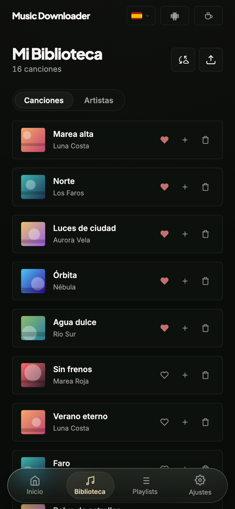
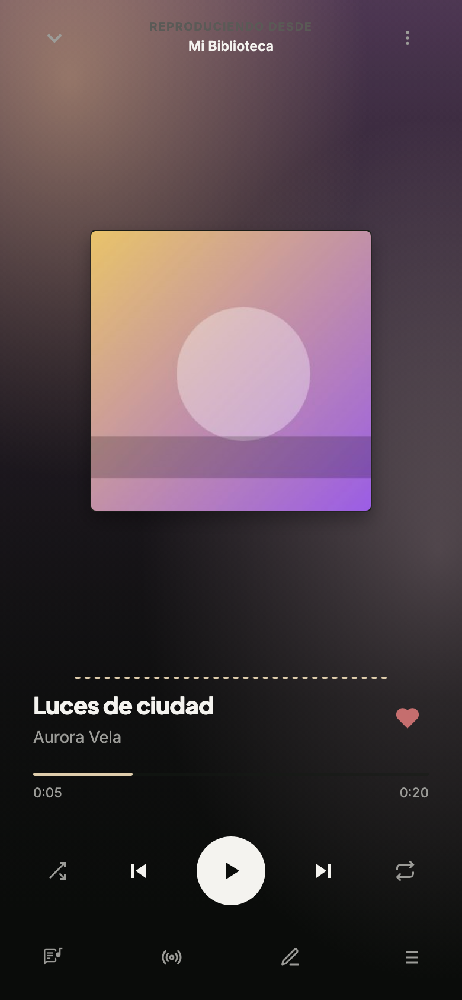
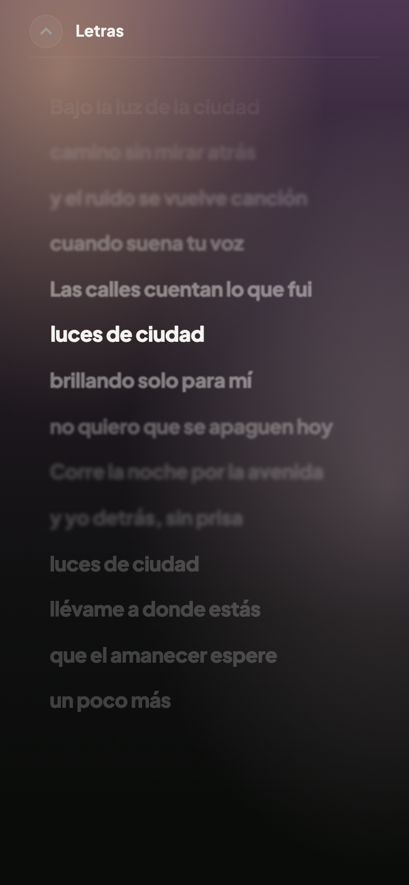
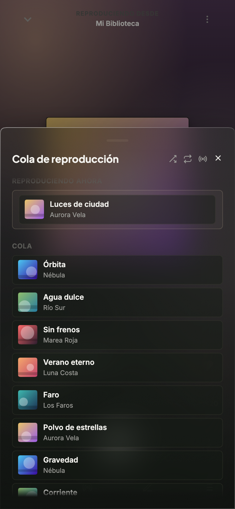
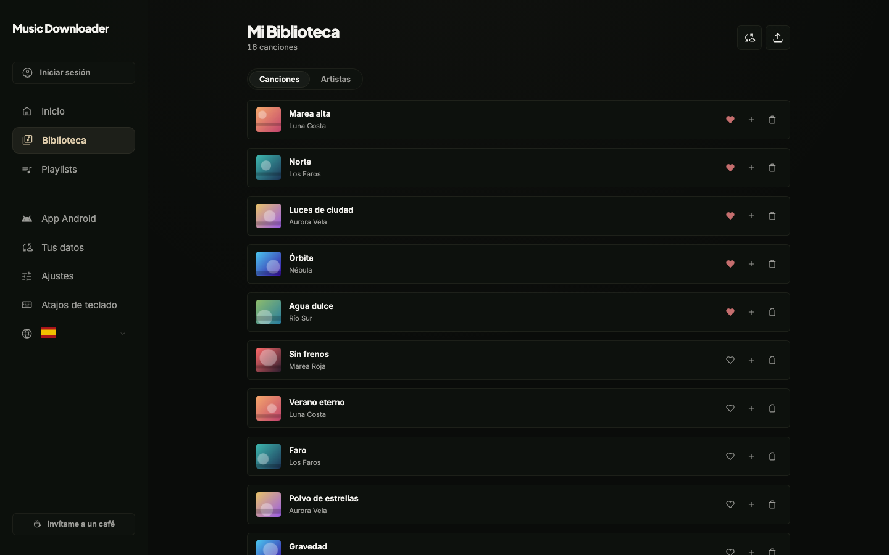
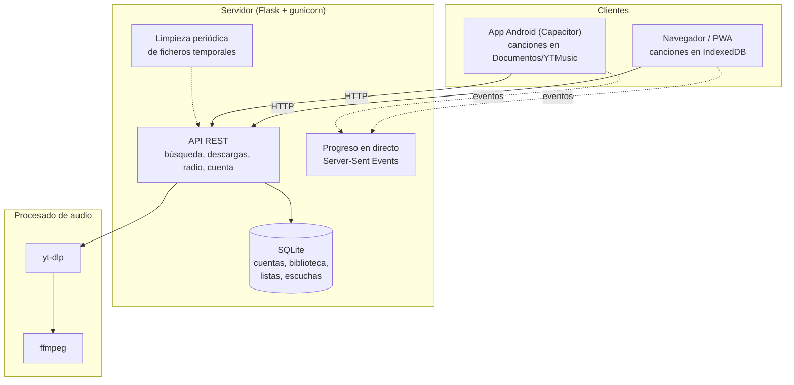

# Music Downloader

Busca una canción o pega un enlace de YouTube, descárgala en M4A o MP3 y escúchala cuando quieras, también sin conexión. Con su reproductor, sus listas, la radio y tu biblioteca en todos tus dispositivos. Funciona en el navegador, se instala como aplicación web (PWA) y tiene su propia app para Android.

**Pruébala en [music.dannarita.es](https://music.dannarita.es)** · **[Descarga la app Android](https://github.com/Ten1O0/YouTube-Music-Downloader/releases/latest)**

[](https://python.org)
[](https://flask.palletsprojects.com/)
[](https://vitejs.dev/)
[](https://developer.mozilla.org/es/docs/Web/Progressive_web_apps)
[](mobile/README.md)
[](test/README.md)
[](LICENSE)

<p align="center">
  
  
  
  
</p>

<sub>Las capturas usan una biblioteca de ejemplo, con artistas inventados y portadas generadas (`node scripts/capturas-readme.mjs`).</sub>

---

## Qué puedes hacer

### Descargar

- **Buscar y descargar** canciones sueltas, *shorts* o listas de reproducción enteras. Las listas se descargan en lote, tres canciones a la vez, con un solo aviso al terminar.
- **Elegir el formato:**
  - **M4A** *(por defecto)*: la pista de audio tal como la sirve YouTube, AAC a unos 128 kbps, sin recodificar. Es la opción más rápida y no pierde calidad.
  - **MP3**: se convierte con `ffmpeg` a VBR V2 (unos 190 kbps) y lleva la carátula y los metadatos incrustados. Para reproductores antiguos que no leen M4A.
- **Importar listas de otros servicios** desde un CSV o una lista de texto (por ejemplo, la exportación de una lista de Spotify). La app busca cada canción, te enseña lo que ha encontrado y descargas las que quieras.
- **Seguir una lista de YouTube**: cuando su autor añade canciones nuevas, la app te avisa.

### Escuchar

- **Sin conexión.** En el navegador, las canciones se guardan en el propio dispositivo y siguen ahí al recargar o sin internet. En Android van a `Documentos/YTMusic/`, así que cualquier reproductor puede abrirlas.
- **Un reproductor completo:** cola que se ordena arrastrando, aleatorio y repetición, letras sincronizadas, controles en la pantalla de bloqueo y un menú ⋮ con las opciones de cada canción.
- **Modo radio:** al acabar la cola (o desde cualquier canción) siguen canciones parecidas, aunque no las tengas descargadas. Se preparan de antemano para que no haya esperas, y si una te gusta, un botón la guarda en tu biblioteca sin volver a descargarla.
- **Ajustes de sonido:** sin cortes o con fundido entre canciones, igualar el volumen y un visualizador.

### Organizar

- **Tu biblioteca**, por canciones o por artistas, con favoritos, listas propias y listas automáticas: *Más escuchadas*, *Añadidas recientemente* y *Sin escuchar*.
- **Corregir el título y el artista** de cualquier canción cuando YouTube los trae mal.
- **Tu año en música:** un resumen de lo que más has escuchado, para verlo o compartirlo como imagen.

### Tu cuenta, si quieres

- **Sin cuenta funciona todo lo anterior.** Si inicias sesión con Google, tu biblioteca, tus listas, tus favoritos y tus escuchas te siguen a cualquier dispositivo. Lo que borras va a una papelera durante 30 días.
- **Tus datos son tuyos:** puedes sacar una copia de seguridad en un fichero, recuperarla en otro dispositivo y borrar tu cuenta desde Ajustes.
- **En tu idioma:** español, inglés, francés, alemán, portugués y chino. Se detecta el del navegador y se puede cambiar a mano.

<p align="center">
  
</p>

---

## Instalarla

- **En el navegador:** abre [music.dannarita.es](https://music.dannarita.es). En el móvil, «Añadir a pantalla de inicio» la instala como una app más.
- **En Android:** descarga `ytmusic.apk` de la [última versión](https://github.com/Ten1O0/YouTube-Music-Downloader/releases/latest) e instálala (Android pedirá permiso para instalar apps de fuera de Google Play). La propia app avisa cuando hay una versión nueva.

> [!NOTE]
> **Si tenías una versión anterior a la 2.0:** la 2.0 está firmada con una clave nueva y Android no la deja instalar encima. Desinstala la antigua una vez e instala la nueva; tus datos vuelven al iniciar sesión, o desde una copia de «Tus datos». Las siguientes versiones ya se instalan encima.
>
> Huella SHA-256 del certificado, para comprobar que la APK es la original:
> `07:28:11:95:C2:A9:F3:7A:21:C4:7D:97:14:01:61:9E:28:F1:E2:91:53:C0:AD:D5:91:9D:C1:53:07:89:BA:0F`

---

## Pruébala en tu equipo

### Requisitos

- **Python 3.10** o superior. En producción se usa Python 3.12. Con 3.9 `pip install` falla, porque gunicorn 25 no publica paquetes para esa versión.
- **Node.js 20** o superior. Sirve para compilar la interfaz, y además `yt-dlp` lo usa para resolver las comprobaciones de YouTube, así que tiene que estar en el `PATH` también en el servidor.
- **FFmpeg** en el `PATH`: `sudo apt install ffmpeg` en Linux, `brew install ffmpeg` en macOS. En Windows también vale descomprimido en `ffmpeg-master-latest-win64-gpl/` dentro del proyecto.

### En cinco minutos

```bash
git clone https://github.com/Ten1O0/YouTube-Music-Downloader.git
cd YouTube-Music-Downloader

python3 -m venv .venv
source .venv/bin/activate          # En Windows: .venv\Scripts\activate
pip install -r backend/requirements.txt

# La interfaz se compila una vez con Vite; el servidor la sirve desde dist/
npm install
npm run build

# El servidor no arranca sin una clave para firmar las sesiones
export JWT_SECRET="$(python3 -c 'import secrets; print(secrets.token_urlsafe(48))')"

python backend/server.py
```

Abre **http://localhost:5000** y ya está.

> [!TIP]
> Si una descarga falla con un error de YouTube, lo primero es actualizar `yt-dlp`: YouTube cambia a menudo y yt-dlp va detrás. Consulta [Actualizar dependencias](#actualizar-dependencias).

---

## Cómo funciona



Esto es lo que pasa cuando pulsas «Descargar»:

1. **La app pide la descarga** (`POST /api/start-download`) y el servidor devuelve un identificador al momento. El trabajo sigue en segundo plano.
2. **El servidor lanza `yt-dlp`**, que extrae el audio. Si pediste MP3, `ffmpeg` lo convierte. Como la conversión consume mucha CPU, solo se hacen dos a la vez.
3. **La app escucha el progreso** por un canal de *Server-Sent Events* y lo pinta en la tarjeta flotante. Si ese canal no está disponible, pasa sola a preguntar cada pocos segundos.
4. **Al terminar, la app se lleva el fichero** y lo guarda en el dispositivo: en IndexedDB en el navegador y en `Documentos/YTMusic/` en Android. Desde ese momento suena sin conexión.
5. **El servidor borra su copia.** Lo que quede huérfano lo retira una limpieza periódica.

La **radio** funciona igual por debajo: el servidor propone canciones parecidas a la que suena (`GET /api/radio`) y la app descarga por adelantado las siguientes a una caché aparte, que no ocupa sitio en tu biblioteca. Guardar una de ellas es moverla de la caché a la biblioteca, sin volver a descargarla.

### Tus datos en varios dispositivos

Cada dispositivo guarda su biblioteca completa y funciona sin conexión. Con sesión iniciada, además apunta cada cambio (una canción nueva, una lista renombrada, un favorito) en un diario que envía a tu cuenta (`/api/sync`) y recoge los cambios de tus otros dispositivos. Lo que borras en uno desaparece en todos, en vez de volver a aparecer desde otro.

Lo que haces sin conexión, o antes de iniciar sesión, no se pierde: queda pendiente y se envía en cuanto vuelve la conexión. La primera vez que inicias sesión en un dispositivo, lo que ya tenía se suma a tu cuenta.

### Estructura del proyecto

| Ruta | Qué contiene |
|---|---|
| `backend/` | El servidor Flask (`server.py`: API, descargas, progreso y limpieza), el acceso a SQLite (`database.py`), la radio (`radio.py`), las descargas en lote (`lotes.py`), la importación de listas (`importar.py`) y sus dependencias. |
| `frontend/` | La interfaz, sin framework: `index.html`, la página de la app (`download.html`), el código en `src/` (organizado por funciones en `src/features/`) y lo que se publica tal cual en `public/` (service worker, manifiesto, versión de la APK). |
| `mobile/` | Proyecto Android con Capacitor. Tiene su [propio README](mobile/README.md). |
| `scripts/` | Compilar la APK (`sync-apk.sh`), generar las capturas de este README, regenerar las curvas de animación y las tareas del servidor (`servidor/`). |
| `test/` | Tests de backend, frontend y recorridos en navegador. Ver su [README](test/README.md). |
| `docs/` | Los planes de mejora con los que se ha ido rehaciendo el proyecto, y el porqué de cada decisión (`docs/planes/`), y las capturas. |

En la raíz solo queda la configuración que las herramientas buscan ahí: `package.json`, `vite.config.js`, `eslint.config.mjs`, `playwright.config.js` y `pyproject.toml`. La compilación sale a `dist/` y las APK a `releases/`; ninguna de las dos se versiona. Las APK se publican en [GitHub Releases](https://github.com/Ten1O0/YouTube-Music-Downloader/releases).

---

## Desarrollo

### Con recarga en caliente

```bash
# Terminal 1: la API
source .venv/bin/activate
python backend/server.py

# Terminal 2: la interfaz con Vite
npm install
npm run dev
```

La interfaz queda en `http://localhost:5173` y Vite reenvía las llamadas a `/api` al servidor del puerto 5000.

### Variables de entorno

| Variable | Obligatoria | Por defecto | Para qué sirve |
|---|:---:|---|---|
| `JWT_SECRET` | **Sí** | — | Clave con la que se firman las sesiones. Sin ella el servidor no arranca. |
| `YTDL_DATA_DIR` | No | `data/` en la raíz del proyecto | Carpeta de la base de datos. En producción conviene sacarla del directorio del proyecto (ver [Despliegue](#desplegar-tu-propia-instancia)). |
| `PORT` | No | `5000` | Puerto de `python backend/server.py`. |
| `HOST` | No | `0.0.0.0` | Interfaz en la que escucha `python backend/server.py`. Por defecto acepta conexiones de toda tu red local; usa `HOST=127.0.0.1` si no quieres eso. |
| `YTDL_SKIP_BOOTSTRAP` | No | — | Evita crear la base de datos y los hilos de limpieza al importar el módulo. Solo para los tests. |
| `YTDL_DISABLE_RATELIMIT` | No | — | Desactiva el límite de peticiones. Solo para los recorridos en navegador. |

### Tests

```bash
npm test                              # backend y frontend de una vez
.venv/bin/pytest test/backend -q      # solo backend
node --test test/frontend/*.mjs       # solo frontend
npm run test:e2e                      # recorridos en un navegador real
npm run lint                          # ESLint
.venv/bin/ruff check .                # estilo y errores comunes en Python
```

Los recorridos de Playwright usan un `yt-dlp` simulado (`test/e2e/fake_ytdlp/`) que genera audio sintético, así que no necesitan internet y siempre dan el mismo resultado. Cada cambio que llega a `main` los ejecuta en GitHub Actions, junto con los tests de backend y frontend.

### Actualizar dependencias

Las versiones de `backend/requirements.txt` están fijadas a propósito: sin fijar, un despliegue podía traer una versión nueva y tumbar el servicio sin que nadie hubiera tocado el código.

`yt-dlp` es la excepción que hay que vigilar, porque es lo primero que se rompe cuando YouTube cambia algo. En el servidor lo actualiza cada día un temporizador (`scripts/servidor/actualizar-yt-dlp.sh`), que además comprueba que sigue extrayendo audio. A mano:

```bash
pip install -U yt-dlp yt-dlp-ejs      # van emparejados
pip freeze | grep -i yt-dlp           # y llevar las versiones a backend/requirements.txt
```

Antes de desplegar, prueba **una búsqueda, una descarga suelta y una lista de reproducción**.

---

## App Android

```bash
npm run sync:apk               # la APK que se publica, en releases/ytmusic.apk
npm run sync:apk -- --debug    # una APK de pruebas; no toca releases/
npm run sync:apk:win           # en Windows: una APK de pruebas
```

El script compila la interfaz, la copia al proyecto Android y genera la APK. La que se publica va firmada con la clave de producción, y el script comprueba su huella antes de dejarla en `releases/`; sin esa clave, usa `--debug`.

La interfaz va **dentro** de la APK, no se descarga del servidor. Por eso funciona sin conexión, pero también significa que un cambio en la interfaz no llega al móvil hasta que se genera e instala una APK nueva. Los detalles, incluida la firma, están en [`mobile/README.md`](mobile/README.md).

---

## Desplegar tu propia instancia

### Qué cambiar antes

El proyecto está configurado para `music.dannarita.es`. Para otro dominio hay que cambiarlo en:

- **`backend/server.py`, `ALLOWED_ORIGINS`**: los orígenes que pueden llamar a la API.
- **`frontend/src/config/env.js`, `SERVIDOR`**: a dónde llama la app Android, que no tiene un dominio propio del que tirar, y adónde vuelve tras iniciar sesión.
- **`GOOGLE_CLIENT_ID`**, en `backend/server.py` y en `frontend/src/features/auth.js`, si quieres inicio de sesión con Google. Necesitas un ID de cliente propio con tu dominio autorizado en la consola de Google Cloud; con el de este proyecto Google rechaza cualquier otro origen.
- **La firma de la APK**: con tu propia clave (ver [`mobile/README.md`](mobile/README.md)).

### Instalación en el servidor

```bash
git clone https://github.com/Ten1O0/YouTube-Music-Downloader.git /var/www/youtube-downloader
cd /var/www/youtube-downloader
python3 -m venv .venv && .venv/bin/pip install -r backend/requirements.txt
npm ci && npm run build            # genera dist/, que es lo que sirve el servidor
```

Para actualizar después: `git pull && npm run build` y reiniciar el servicio.

### Servicio con systemd

El progreso de cada descarga vive en la memoria del proceso. Con varios *workers*, la petición de progreso puede caer en uno que no sabe nada de esa descarga, y la barra avanza a saltos. Por eso se usa **un solo worker con muchos hilos**:

```ini
[Unit]
Description=Music Downloader
After=network.target

[Service]
User=www-data
WorkingDirectory=/var/www/youtube-downloader
EnvironmentFile=/etc/default/youtube-downloader
ExecStart=/var/www/youtube-downloader/.venv/bin/gunicorn \
    --workers 1 \
    --threads 32 \
    --timeout 120 \
    --bind 127.0.0.1:5000 \
    --chdir /var/www/youtube-downloader/backend \
    server:app
Restart=always

[Install]
WantedBy=multi-user.target
```

Y en `/etc/default/youtube-downloader`, con permisos `600`:

```bash
JWT_SECRET=<una clave larga y aleatoria>
YTDL_DATA_DIR=/var/lib/youtube-downloader
```

> [!IMPORTANT]
> Escucha en `127.0.0.1`, no en `0.0.0.0`. Si el puerto 5000 queda abierto a internet, cualquiera puede saltarse nginx: las sesiones viajan sin cifrar y el límite de peticiones por IP deja de servir.

### nginx delante

```nginx
server {
    server_name tu-dominio.com;
    # (certificado TLS, por ejemplo con Certbot)

    # Progreso en directo: sin buffering, o nginx retiene los eventos
    # y la barra de progreso no se mueve hasta el final.
    location /api/progress/stream/ {
        proxy_pass http://127.0.0.1:5000;
        proxy_set_header Host $host;
        proxy_set_header X-Forwarded-For $proxy_add_x_forwarded_for;
        proxy_set_header X-Forwarded-Proto $scheme;
        proxy_http_version 1.1;
        proxy_set_header Connection "";
        proxy_buffering off;
        proxy_cache off;
        proxy_read_timeout 3600s;
    }

    location / {
        proxy_pass http://127.0.0.1:5000;
        proxy_set_header Host $host;
        proxy_set_header X-Real-IP $remote_addr;
        proxy_set_header X-Forwarded-For $proxy_add_x_forwarded_for;
        proxy_set_header X-Forwarded-Proto $scheme;
        proxy_read_timeout 300;
    }
}
```

Las cabeceras `X-Forwarded-*` hacen falta: el servidor confía en un proxy delante y saca de ellas la IP real del usuario para el límite de peticiones.

---

## API

Todas las rutas aceptan y devuelven JSON, salvo las que entregan audio o eventos.

**Límite de peticiones.** Salvo que se indique otra cosa, cada IP puede hacer 200 peticiones por hora. Están exentas las rutas que se consultan en bucle mientras dura una descarga y las que sirven la propia página: en redes móviles muchos usuarios comparten IP, y si no, bastarían unas pocas recargas entre todos para bloquear la web. Las rutas de la cuenta cuentan por usuario, no por IP.

**Topes de descargas.** Cada cuenta (o IP, sin sesión) puede descargar 100 canciones por hora, y el servidor entero, 600: cuentan las descargas sueltas, los lotes, los ZIP y la radio. Son la forma de no llamar la atención de YouTube. Cuando hay que parar, la respuesta lleva un `code` que la app traduce:

| Código | Respuesta | Qué pasa |
|---|---|---|
| `hour_limit` | `429` | Esta cuenta o IP ha llegado a sus 100 canciones de la hora. Lleva también `quedan`. |
| `server_busy` | `429` | El servidor ha llegado a sus 600 de la hora. |
| `youtube_limit` | `503` | YouTube está limitando al servidor (pide demostrar que no es un robot). Durante 10 minutos no se intenta ninguna descarga nueva. Una descarga en curso termina con `code: "error_youtube_limit"` en su progreso. |

### Búsqueda, descarga y radio

No necesitan cuenta.

| Método | Ruta | Qué hace | Límite |
|---|---|---|---|
| `POST` | `/api/search` | Busca canciones, vídeos o listas. | 20/min |
| `POST` | `/api/playlist-info` | Devuelve las canciones de una lista. | 10/min |
| `POST` | `/api/start-download` | Empieza una descarga. Cuerpo: `{"url": "...", "format": "m4a" \| "mp3"}`. | 10/min y 100/h |
| `POST` | `/api/lotes` | Descarga varias canciones (hasta 100), de tres en tres. Cuenta para los topes. | 3/min y 20/h |
| `GET` | `/api/lotes/<id>` | Cómo va el lote. | exenta |
| `DELETE` | `/api/lotes/<id>` | Cancela el lote. | 10/min |
| `GET` | `/api/lotes/<id>/zip` | Lo terminado del lote, en un ZIP. | 10/min |
| `POST` | `/api/start-batch-download` | Varias canciones en un ZIP (la vía anterior a los lotes). | 3/min y 20/h |
| `GET` | `/api/progress/stream/<id>` | Progreso en directo (*Server-Sent Events*). Máximo 40 conexiones abiertas en todo el servidor. | exenta |
| `GET` | `/api/progress/<id>` | Progreso en una consulta suelta, como alternativa. | exenta |
| `POST` | `/api/cancel/<id>` | Cancela una descarga en curso. | general |
| `GET` | `/api/download/<id>` | Entrega el fichero terminado. | exenta |
| `GET` | `/api/stream/<id>` | Sirve el audio por tramos, para reproducirlo sin descargarlo entero. | exenta |
| `DELETE` | `/api/download/<id>` | Borra del servidor los ficheros de una descarga. | general |
| `GET` | `/api/radio?semilla=<id>` | Canciones parecidas a la indicada, para la radio. | 20/min |
| `GET` | `/api/app/version` | La última versión de la APK y sus novedades. | general |
| `GET` | `/api/health` | Estado del servicio. | exenta |

### Cuenta

Inicio de sesión con Google. Las rutas de la cuenta necesitan la cabecera `Authorization: Bearer <token>`, y el token dura 30 días.

| Método | Ruta | Qué hace | Límite |
|---|---|---|---|
| `POST` | `/api/auth/google` | Canjea la credencial de Google por un token de sesión. | 10/min |
| `GET` | `/auth/native` | Abre el inicio de sesión desde la app Android. | general |
| `POST` | `/auth/native/callback` | Vuelta de Google hacia la app Android. | 10/min |
| `GET` | `/api/auth/me` | Datos del usuario de la sesión. | general |
| `DELETE` | `/api/account` | Borra la cuenta y todo lo que el servidor guarda de ella (biblioteca, listas, favoritos, escuchas, historial, ajustes, listas seguidas y registro de descargas). El token deja de valer. | 5/h |
| `GET` · `POST` | `/api/sync` | Recoge los cambios de la cuenta desde un punto (`?desde=N`) o envía los del dispositivo, todos o ninguno. | 30/min |
| `POST` | `/api/sync/escuchas` | Guarda las escuchas del dispositivo. | 30/min |
| `GET` | `/api/sync/eliminadas` | La papelera: canciones borradas en los últimos 30 días. | 30/min |
| `POST` | `/api/sync/restaurar` | Devuelve canciones de la papelera a la biblioteca. | 30/min |
| `GET` · `POST` | `/api/follows` | Las listas de YouTube que sigues, con sus canciones nuevas, o seguir una más. | 30/min · 10/min |
| `DELETE` | `/api/follows/<id>` | Deja de seguir una lista. | 10/min |
| `POST` | `/api/follows/entregadas` | Marca como recogidas las canciones nuevas de las listas seguidas. | 30/min |
| `GET` | `/api/resumen/escuchas` | Las escuchas de un año, para «Tu año en música». | 10/min |
| `POST` | `/api/import/match` | Encarga la búsqueda de una lista importada (hasta 500 canciones). | 2/h |
| `GET` | `/api/import/match/<id>` | El resultado del encargo, o lo que lleva. Caduca a la hora. | 60/min |
| `GET` · `POST` · `DELETE` | `/api/user/history` | Lee, añade o vacía el historial de descargas. | general |
| `GET` · `POST` | `/api/user/favorites` | Lee o añade favoritos. | general |
| `DELETE` | `/api/user/favorites/<video_id>` | Quita un favorito. | general |
| `POST` | `/api/user/sync` | Sube la biblioteca del dispositivo la primera vez que se inicia sesión en él. | general |

---

## Limitaciones conocidas

- **Un solo proceso.** Por cómo se guarda el progreso, el servidor no puede repartirse entre varios *workers* ni varias máquinas.
- **Depende de YouTube.** Cuando YouTube cambia algo, las descargas pueden fallar hasta que se actualiza `yt-dlp`. Y si recibe demasiadas descargas desde la misma IP, YouTube puede pedir que se demuestre que no es un robot; mientras dure, la app lo avisa y hay que esperar un rato.
- **No está en Google Play**, porque sus normas no admiten apps que descargan de YouTube. Se instala desde la web o desde GitHub.

---

## Privacidad

La app no tiene publicidad ni rastreadores. Sin cuenta, tu música y tus listas solo están en tu dispositivo. Con cuenta, se guardan tu correo, tu nombre, tu foto de perfil de Google y lo que sincronizas, y puedes borrarlo todo desde Ajustes. El registro de descargas, que sirve para saber cuánto se usa el servicio, se borra solo a los 90 días. Los detalles están en la [política de privacidad](https://music.dannarita.es/privacidad).

---

## Licencia y aviso

Distribuido bajo la [licencia MIT](LICENSE): puedes usarlo, copiarlo, modificarlo y redistribuirlo como quieras, también con fines comerciales, siempre que conserves el aviso de copyright.

Este proyecto es un ejercicio personal y no tiene relación con YouTube ni con Google. Descargar contenido de YouTube puede ir contra sus condiciones de uso o contra los derechos de autor de quien lo publicó: úsalo solo con contenido que tengas derecho a descargar.
